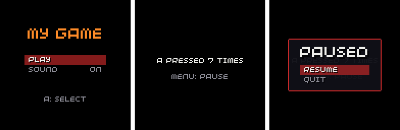

# Game template

[](https://github.com/chili-chip/game-template/actions/workflows/build.yml)

This is a basic template for starting game projects for the chilichip console, using the 32blit SDK and the
[chili game SDK](https://game-sdk.chilichip.eu/). It shows the code layout and asset pipeline, and comes with a
title menu, a pause menu and a save file, so a new game starts from something that already works.



**Documentation:** tutorials, example games and the API reference are at
<https://sdk.chilichip.eu/>. New to the SDK? Start with
[Getting started](https://sdk.chilichip.eu/getting-started/).

It's based on the original `template` project from the 
[32blit-boilerplate](https://github.com/32blit/32blit-boilerplate), with added support for chilichip's vgc zero.

## Getting started

If this is your first 32blit game, follow the [Linux quickstart](https://chilichip.eu/docs/game-sdk/quickstart/linux-quickstart/)
on chilichip.eu first. It installs the toolchain and clones `32blit-sdk`, `pico-sdk` and `pico-extras` next to your game.
CMake 3.28 or newer is needed to use the presets in `CMakePresets.json` (`vgc`, `vgc-blit`, `linux`).

## Usage

[Use this template](https://github.com/chili-chip/game-template/generate) to
generate your own project.

* Edit the CMakeList.txt file to set the name of your project
* Edit the metadata.yml file to set the information for your project
* Edit `game.cpp`: set your own save id (the four letters in `save(...)`) and replace the play scene with your game
* Edit the LICENSE file to set your name on the license
* Write lots of super cool code!

You should then be able to follow the usual build instructions.

For local builds this is:
```
mkdir build
cd build
cmake -D32BLIT_DIR=/path/to/32blit-sdk/ ..
```

## Building for the VGC Zero

The VGC Zero runs ChiliChip OS: a system loader that stays in flash and installs any number of
games as `.blit` files. This is the normal way to ship a game. Check out
[32blit-sdk](https://github.com/chili-chip/32blit-sdk) and
[pico-sdk](https://github.com/chili-chip/pico-sdk) next to this project, then build with the
`vgc-blit` preset:

```
cmake --preset vgc-blit
cmake --build out/build/vgc-blit
```

This produces `out/build/vgc-blit/game.blit`. Without presets, use:

```
mkdir build.vgc-blit
cd build.vgc-blit
cmake .. \
  -D32BLIT_DIR=../../32blit-sdk \
  -DPICO_SDK_PATH=../../pico-sdk \
  -DPICO_BOARD=chilichip_vgc \
  -DPICO_PLATFORM=rp2350-arm-s \
  -DCMAKE_TOOLCHAIN_FILE=../../32blit-sdk/pico2.toolchain \
  -DBLIT_EXECUTABLE_PICO_BLIT=1
make
```

### Installing on the console

1. Plug the console into your computer. A drive named **CHILICHIP** appears.
2. Copy `game.blit` onto the drive, then eject it (or unplug the cable).
3. The console installs the game with a progress bar, removes the copy from the drive and shows it
   on the home screen.

Copying a newer build of the same game replaces the old one and keeps its saves. `32blit install game.blit`
over USB still works too. If the console says "Needs a system update", the game was built against a newer
SDK than the console's loader: flash the latest loader (see
[Flashing](https://sdk.chilichip.eu/console/flashing/)).
"Not a ChiliChip game" means the file was built for another device, usually because `PICO_PLATFORM` was
not `rp2350-arm-s`.

### How the game appears on the home screen

`metadata.yml` sets what the home screen shows: `title`, `author`, `version` and `description` on the
game's info page, and the `splash` image as the game's cover in the carousel. Make the splash 128x96;
without one the game gets a coloured title card. Keep `category: game` (a `launcher` replaces the home
screen).

### What is in game.cpp

`game.cpp` uses the [chili game SDK](https://game-sdk.chilichip.eu/), which CMake downloads with
`FetchContent` on the first configure. Each part is short, so you can keep what you need:

| Part | What it does | SDK docs |
| --- | --- | --- |
| `Title` scene | A menu with PLAY and a SOUND toggle | [Menu](https://game-sdk.chilichip.eu/menu/) |
| `Play` scene | Counts presses of A. MENU opens a pause menu with RESUME and QUIT | [Scenes](https://game-sdk.chilichip.eu/scenes/) |
| `save` | Keeps the press count and the sound setting | [Save](https://game-sdk.chilichip.eu/save/) |
| `sfx_blip` | The menu and button sound | [Music and sound](https://game-sdk.chilichip.eu/audio/) |

The SDK also has name entry, high score tables, music, particles and screen shake. See the
[demo game](https://game-sdk.chilichip.eu/demo/) for all of them in one file.

The SDK version is pinned with `GIT_TAG` in `CMakeLists.txt`, so a new SDK release never changes your game until you
bump it.

### Saving progress

`chili::Save<SaveData>` keeps a plain struct in a file. `init()` calls `save.load()`, which gives the defaults when
there is no save yet, and `save.store_on_quit()`, which writes it when the player quits to the home screen (from
the system menu or by holding HOME). Quitting from the pause menu also saves.

Saves live in `.blit/<title>/` on the console's drive, so they are kept when the game is updated, and deleting the
game from the home screen asks whether to delete them too. The console has a hard power switch, so also save at
checkpoints rather than only on quit. When you change `SaveData`, bump the version number in `save(...)`: an
older file then loads as defaults instead of as garbage. `on_quit` needs a console with the API 0.5 loader.

### Standalone builds

The `vgc` preset (the same cmake command without `-DBLIT_EXECUTABLE_PICO_BLIT=1`) builds a standalone
`game.uf2` that you copy to the console in BOOTSEL mode. It is handy for quick tests and debugging over
SWD, but it replaces ChiliChip OS: flash `blit-loader.uf2` again afterwards to get the home screen back.

### CI builds

Every push builds the game for each platform. The VGC jobs upload `game-blit` (ready to copy onto the
console) and `game-uf2` as workflow artifacts, and check that the `.blit` is built for the VGC Zero.
Publishing a GitHub release also attaches `game.blit` to it.

[Detailed instructions for the VGC Zero](https://sdk.chilichip.eu/getting-started/build-console/)

Platform and editor specific instructions are in the
[Setup section of the docs](https://sdk.chilichip.eu/setup/linux/)
(for [Visual Studio](https://sdk.chilichip.eu/setup/visual-studio/), follow the "Option 2" instructions, as the template does not contain a solution file)

## VS Code Setup (Optional but Recommended)

For the best development experience with VS Code, install these extensions:
- **CMake Tools** - For building and configuring the project with CMake
- **Cortex-Debug** - For debugging on the Pico 2 with OpenOCD

These extensions enable integrated building, flashing, and debugging directly from VS Code.

## Flashing to Pico via SWD

Make sure you have:
- raspberrypi's [openocd fork ](https://github.com/raspberrypi/openocd) installed (rp2350 support not yet in openocd) 
- Pico Debugger or Picoprobe connected via SWD pins (SWDIO, SWCLK, GND)
- The game has been built successfully (produces `game.elf`)


To flash a standalone build to the console using the Pico Debugger over SWD:

```bash
cd build
openocd -f interface/cmsis-dap.cfg -f target/rp2350.cfg -c "adapter speed 5000; program "game.elf" verify reset exit"
```

## Contributing to this template

This repo has two audiences:

- **Making a game?** Click [Use this template](https://github.com/chili-chip/game-template/generate) and work in your
  own repository. Problems with your game belong there.
- **Improving the template itself?** Open an issue or pull request here. Changes that every new game should get belong
  in this repo: build setup, CMake presets, CI, the asset pipeline and these docs. SDK bugs and features go to
  [32blit-sdk](https://github.com/chili-chip/32blit-sdk) instead.

The placeholder name in `LICENSE` is intentional: each game sets its own.
